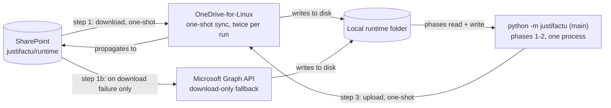
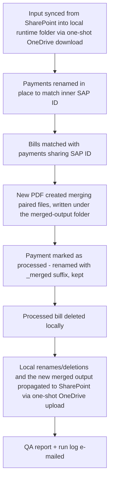

# Justifactu — Technical Documentation

## Contents

1. [Overview](#1-overview)
2. [Architecture](#2-architecture)
3. [Components](#3-components)
4. [Data flow](#4-data-flow)
5. [Identifiers & naming conventions](#5-identifiers--naming-conventions)
6. [Configuration](#6-configuration)
7. [Running it](#7-running-it)
8. [Testing](#8-testing)
9. [Known limitations](#9-known-limitations)
10. [Glossary](#10-glossary)

---

## 1. Overview

- Justifactu automates matching and merging bills (*facturas*) with their corresponding payments (*remeses*) stored in
  SharePoint. Payments are renamed to the SAP ID found in their PDF content; bills, already named with their SAP ID,
  are matched against that renamed set and combined into a single justification PDF per pair.

- The pipeline runs every few days, keeping the volume of unprocessed documents manageable between runs. It operates
  independently of Finances or any other department's systems or schedule.

- Justifactu replaces a manual, repetitive process that previously took significant time each month from the people
  responsible for these justifications. Automating the matching and merging leaves only the final review as manual
  work.

---

## 2. Architecture

For the full design rationale and decision log, see
[onedrive_sync_and_orchestration.md](onedrive_sync_and_orchestration.md); this section gives the short version needed
to understand where the data in the rest of this document comes from.



- SharePoint is still the single source of truth. **It is not continuously synced** — `main()` runs a single,
  one-shot OneDrive-for-Linux download before anything else, runs the phases entirely against the local copy, then
  runs a single one-shot upload afterward. There is no 5-minute background mirror in the production design; that
  was the local-dev-only `compose.yml` sidecar (`onedrive --monitor`), which is a different, non-production setup
  (kept per a deliberate decision — see D18 in the companion document).

> [!IMPORTANT]
> Core design principle: local files are a disposable cache between runs, and only SharePoint changes are durable.

- **One container in production, not two.** The original design split `app` and a long-running `onedrive` sidecar.
  The actual design runs `onedrive` as a one-shot subprocess *from inside* the same process as the app (via
  `onedrive_sync.py::run_onedrive_sync`), bracketing the phases — see the companion document, Section 6, for the
  full orchestration detail. `compose.yml`'s two-container shape still exists, but only as a local-dev convenience.
- **A Microsoft Graph fallback exists for the download step only.** If the OneDrive sync fails, `main()` falls back
  to a direct Graph API download (`sharepoint.py::connect_sharepoint`/`download_input_folder`) before giving up.
  There is **no** equivalent fallback for uploads — SharePoint is only ever written through the one-shot
  `onedrive --upload-only` call.

---

## 3. Components

| Area | Files | Key functions | Responsibility |
|---|---|---|---|
| **Ingestion & matching** | `bills.py`, `payments.py`, `process.py` | `parse_bill_filename`, `parse_sap_id_from_bill`, `index_payments`, `rename_payments`, `merge_bills_and_payments`, `cleanup_processed_files` | Extracts the SAP ID from each side — from the bill's filename via regex, from the payment's PDF content via `pypdf` — matches bills to payments on that shared ID, renames payments **in place**, and after a successful merge marks the payment `_merged` and removes the processed bill. |
| **Path composition** | `defines.py`, `paths.py`, `defaults.py` | `FolderName`, `Mode`, `bills_folder`, `payments_folder`, `merged_output_folder`, `qa_errors_folder`, `year_merged_folder`, `default_onedrive_data_folder`, etc. | `defines.py` holds every folder/file-name segment as bare `StrEnum` values and nothing else; `paths.py` composes those segments into real runtime `Path`s given an already-resolved base directory and a `Mode`; `defaults.py` composes the `ROOT_FOLDER`-relative fallback paths `arguments.py`'s CLI flags fall back to. No other module hardcodes a folder/file-name string literal. |
| **PDF generation** | `pdf.py` | `merge_pdfs` | Combines a matched bill and payment into the single output PDF that gets uploaded to SharePoint. |
| **SharePoint integration** | `sharepoint.py`, `token_manager.py`, `onedrive_sync.py` | `run_onedrive_sync`, `run_onedrive_auth`, `connect_sharepoint`, `download_input_folder`, `TokenManager.get_token` | `onedrive_sync.py` shells out to the real `onedrive` binary for the primary download/upload sync and the one-time `--auth` bootstrap. `sharepoint.py`/`token_manager.py` back only the **download** step, as a fallback if the primary sync fails — there is no remote rename/delete/upload capability in this codebase at all; every mutation to SharePoint goes through the `onedrive --upload-only` call. |
| **Secrets** | `secret.py`, `vault.py`, `defaults.py` | `read_secret`, `_VaultClient`, `default_secrets_folder` | Resolves credentials through a fallback chain (mounted secret file → `default_secrets_folder()` → environment variable → HashiCorp Vault via AppRole), so the same code runs unmodified in local dev and in the deployed containers. |
| **Logging & QA reporting** | `logger.py` | `configure_logging_from_settings`, `get_logger` | Standard logging, plus a tagging mechanism (`extra={"qa_report": True}`) that lets any log call anywhere in the codebase mark itself as QA-report-worthy; a dedicated filtered handler collects only those into the separate QA report file. `GENERAL_OUTPUT_FOLDER`/`ADMIN_LOG_FOLDER` compose from `FolderName.GENERAL_OUTPUT`/`ADMIN_LOGS`, not hardcoded strings. |
| **Mailing** | `mail.py`, `notify.py` | `send_mail_authenticated`, `send_qa_report_mail` | SMTP delivery (STARTTLS) of the end-of-run notification, with the QA report and full run log attached as files rather than pasted into the body. `notify.py` (`justifactu-notify` console script) is a separate, standalone entry point for one-off notification emails (used by the Jenkinsfile's `post` blocks), letting exceptions propagate instead of swallowing them the way `main()`'s own mail call does. |
| **CLI / entry point** | `arguments.py`, `main.py`, `__main__.py` | `process_parse_arguments`, `main` | Defines the real CLI surface: `-l/--location`, `--auth`, `--dry-run`, `--onedrive-data-folder`, `--onedrive-conf-folder`, `--sharepoint-sync-folder`, `--runtime-location`, `-p/--phase`, `--mode`. (`--input-location`/`--download-input`/`--download-subfolder` **do not exist**.) `main()` parses args once, handles an early-return `--phase` path for isolated single-stage testing, the `--auth` bootstrap, the sync/phases/sync orchestration, and the QA-report mail in a `finally` block. `__main__.py` is a one-line wrapper: `if __name__ == "__main__": main()`. |

---

## 4. Data flow



---

## 5. Identifiers & naming conventions

- SAP ID: formed by the corresponding year and a 6-digit number. Bills are already named based on it, while payments
  receive theirs from their PDF content.

- File naming stages for payments:

  ```mermaid
  flowchart LR
      A[Original bank filename]
      B[sap_id-P]
      C[sap_id-P_merged]

      A -->|rename_payments| B
      B -->|cleanup_processed_files| C
  ```

### Local/SharePoint folder layout — rewritten

The original `_input`/`FACTURES`/`Remeses`/`_output`/`QA` layout described here is stale on two counts: the
top-level split was `_input`/`_output`, and there was no test/production distinction. The actual layout, scoped
under one synced directory (`justifactu/runtime`):

```text
justifactu/runtime/                          # the one remote-synced directory (--single-directory)
├── FACTURES/                                 # Mode.PROD bills   (FolderName.BILLS_INPUT_PROD)
├── Remeses/                                  # Mode.PROD payments (FolderName.PAYMENTS_INPUT_PROD)
├── carpeta_proves/                           # only present/used under Mode.TEST (the default)
│   ├── FACTURES_prova/                       # Mode.TEST bills   (FolderName.BILLS_INPUT_TEST)
│   └── Remeses_prova/                        # Mode.TEST payments (FolderName.PAYMENTS_INPUT_TEST)
└── _output/
    └── FACTURES+PAGAMENTS/
        ├── QA_ERRORS/                         # QA report + run log copied here after each full run
        └── <year>_FACTURA+PAGAMENT/           # one subfolder per year with matched bills
            └── {sap_id}_F_P.pdf               # the merged output PDF for one bill+payment pair
```

Which pair (`FACTURES`/`Remeses` vs. `FACTURES_prova`/`Remeses_prova` under `carpeta_proves`) a run reads from is
controlled entirely by the `--mode {prod,test}` CLI flag (default `test`) — see
[onedrive_sync_and_orchestration.md, D29](onedrive_sync_and_orchestration.md#d29--mode-prodtest-replaces-an-env-var-only-switch---phase-adds-an-isolated-single-stage-test-path)
for the full rationale. The merged-output structure under `_output/` is the same regardless of mode.

| Process | Output location | Naming convention | Example |
|---|---|---|---|
| Payment file renaming | **In place**, inside the payments folder (not a separate output location) | `(?P<year>20\d{2})(?P<sapid>\d{6})-P.pdf` | `2025000458-P.pdf` |
| Fused bill and payment pdf | `_output/FACTURES+PAGAMENTS/<year>_FACTURA+PAGAMENT/` | `(?P<year>20\d{2})(?P<sapid>\d{6})_F_P.pdf` | `2025000458_F_P.pdf` |
| General log (copied after a full run) | `_output/FACTURES+PAGAMENTS/QA_ERRORS/` | `%Y-%m-%d_%H-%M-%S.log` | `2026-09-02_09-51-52.log` |
| QA log (copied after a full run) | `_output/FACTURES+PAGAMENTS/QA_ERRORS/` | `%Y-%m-%d_%H-%M-%S_qa_report.log` | `2026-09-02_09-51-52_qa_report.log` |

The QA/general-log copy step only happens on a **full** run (no
`--phase` flag) — `main()` copies them in after `run_all_phases()` completes, right before the upload sync; a
`--phase`-only invocation never reaches that code at all (see the companion document, Section 7.1a).


### 5.1 Extracting the SAP ID from a bank payment PDF

Inside the payment PDF, the SAP ID sits next to a fixed marker: `Fra. <SAP ID>` (e.g. `Fra. 2025003695`). The parser
(`bills.py::parse_sap_id_from_bill`) looks for that marker with the regex `(Fra\.?\s+)` followed by a 4-digit year and
a 6-digit sequence — the period is optional and the whitespace is `\s+` (matches spaces *and* newlines), which is what
lets a single pattern cover both formats seen in practice:

| Bank source             | Marker as it appears in the PDF                                                   | Notes                                                                                                                                                               |
|-------------------------|-----------------------------------------------------------------------------------|---------------------------------------------------------------------------------------------------------------------------------------------------------------------|
| BBVA, before 27/04/2026 | `Fra. 2025003695` (period + space)                                                | Original format                                                                                                                                                     |
| BBVA, from 27/04/2026   | `Fra` on one line, `2025003695` on the next (no period, newline instead of space) | BBVA changed their statement layout; `\s+` already matches the newline and `\.?` already makes the period optional, so this format is covered without a code change |
| Sabadell                | `Fra. 2025000549` (period + space)                                                | Same format as BBVA's original                                                                                                                                      |

The resulting output naming (`{sap_id}-P.pdf`, hyphen not underscore) is already covered by the "Payment file renaming"
row in the table above.

### 5.2 Bill naming (Docuware)

Bills are downloaded from Docuware already named `F {sap_id}` (note the space after `F`) —
`bills.py::parse_bill_filename` matches that exact shape. Since 20/05/2025, bills entering Docuware get the SAP
document number written into the filename directly when the document is accounted for, replacing the older manual
process (scan the paper bill, split the PDF, name it by hand). Bills logged before that date were retroactively
renamed to the same convention as a one-off cleanup.

> [!NOTE]
> Downloading bills from Docuware is **not automated yet** — it's currently a manual, roughly-weekly step. Automating
> it (nightly, or timed to coincide with the bank payment download) is a planned follow-up, not yet scheduled.

### 5.3 Matching and merging

A bill (`F {sap_id}`) and a payment (`{sap_id}-P`) are matched purely on a shared SAP ID — `merge_bills_and_payments`
builds a payment map keyed by SAP ID and looks up each bill against it. When both exist, they're merged **bill first,
then payment** into the single fused PDF named per the "Fused bill and payment pdf" row above.

> [!NOTE]
> The original process description calls for deleting *both* source files after a successful merge — the bill and the
> bank payment PDF. The current implementation deletes the bill but only **renames** the payment (appending
> `_merged`) rather than deleting it, keeping it as a lightweight audit trail of which payment file produced which
> merge. Flagging this as a divergence from the original spec worth confirming is intentional, not an oversight.

> [!WARNING]
> The original process notes describe payments being consolidated into a distinct `_input/-stages/1/Pagaments` folder
> after renaming, before the merge step. That doesn't match the SharePoint folder layout documented above, where
> renaming happens in place under `Remeses` with no separate consolidation folder. Flagging the discrepancy rather
> than resolving it here — worth checking which one is current.

### 5.4 What doesn't get matched

A bill with no matching payment isn't necessarily an error — it likely belongs to a payment method handled outside
this flow: card payments, travel expenses, direct debits (*domiciliacions*), etc. Those go through a separate "own
treatment" process (Phase 3 — see `phase3_credit_cards.md`) rather than the bank-remittance matching described here.

---

## 6. Configuration

### Secrets

<table>
<tr><th>SharePoint</th><th>SMTP</th></tr>
<tr valign="top">
<td>

- `CLIENT_ID`
- `CLIENT_NAME`
- `CLIENT_SECRET`
- `OBJECT_ID`
- `SHAREPOINT_DOMAIN`
- `DRIVE_ID`
- `SITE_NAME`
- `TENANT_ID`

</td>
<td>

- `SMTP_PASSWORD`
- `SMTP_PORT`
- `SMTP_DEVELOPER_EMAIL`
- `SMTP_SERVER`
- `SMTP_USERNAME`
- `SMTP_ADMIN_EMAIL`
- `SMTP_OWNER_EMAIL`

</td>
</tr>
</table>

### `service/onedrive/conf/config`

| Setting | Still in `config`? | Description |
|---|---|---|
| `sync_dir` | Present, but dead | `--syncdir`, passed on every invocation, overrides it regardless of what's written here. |
| `drive_id` | Present, as a placeholder `""` | Written in and erased back out per individual `onedrive` call — see Secrets above. |
| `cleanup_local_files` | **Removed** | Now a per-call flag (`--cleanup-local-files`), appended only on the download call. |
| `download_only` | Not present | Direction is chosen per call (`--download-only`/`--upload-only`), not statically configured. |
| `monitor_interval` | Not present | No `--monitor` mode is used in production; this key only applies to that mode. |

> [!WARNING]
> `drive_id` is a live secret while it's briefly present in this file during a call — do not modify it manually, and
> don't assume a non-empty value in this file at rest is meaningful; it should be `""` outside of an active
> `onedrive` invocation.

### `compose.yml`

It defines two services, which have healthchecks to ensure they are working properly, and with one dependency between them:

| Service | Description |
|---|---|
| `app` | Builds from the local `Dockerfile`, and won't start until `onedrive`'s healthcheck passes. It mounts the shared sync directory. |
| `onedrive` | Long-running service running `onedrive --monitor` — this mode is **not** used in production, where `onedrive` is invoked as two one-shot calls from inside `main()` instead (Section 2). |
---

## 7. Running it

### Local dev setup

1. Install dependencies:

   ```bash
   make install
   ```

2. Run the pipeline:

   ```bash
   make run CMD=""
   ```

> [!TIP]
> `make run` alone just prints `--help`, since `CMD` defaults to that — always override it explicitly.

### Common invocations

| Goal | Command |
|---|---|
| Default run against SharePoint, test-mode folders (the default) | `make run CMD=""` |
| Default run against SharePoint, production folders | `make run CMD="--mode prod"` |
| One-time OAuth bootstrap for a fresh `confdir` | `make run CMD="--auth"` |
| Preview a sync without applying it | `make run CMD="--dry-run"` |
| Run phase 1 only (payment renaming), skipping any sync | `make run CMD="--phase 1"` |
| Run phase 2 only (matching + merging), skipping any sync | `make run CMD="--phase 2"` |
| Run against a specific local data directory instead of the default | `make run CMD="--onedrive-data-folder /path/to/data"` |
---

## 8. Testing

Run the test suite with `make test` (`PYTHONPATH=src pytest -s -v`, per the project `Makefile`). The suite mocks
external calls (SMTP, Graph API, `subprocess` calls to the real `onedrive` binary) rather than hitting real services,
since local files and live SharePoint state are explicitly not the source of truth for what's "correct" here —
tests assert against the code's own composition and dispatch logic (e.g. `tests/test_paths.py`,
`tests/test_defaults.py`, `tests/test_main.py`), not against a real synced tree.

---

## 9. Known limitations

> [!CAUTION]
>
> - Bill deletion after merge is irreversible. Depending on future needs, we might move deleted items to the trash
>   instead of a direct deletion.
> - Local mirror lag relative to SharePoint. Since OneDrive-For-Linux takes minutes to read, check, and download new
>   content and erase the ones not mirrored in SharePoint, the process could incur some syncing lag. However, this
>   pipeline is designed to be run once every few days, so it should have ample time to sync before each full run.
> - No network timeouts on HTTP calls yet.
> - Bill ingestion from Docuware is still a manual, weekly step (see [§5.2](#52-bill-naming-docuware)) — not yet part
>   of the automated pipeline.
> - Phase 3 ("own treatment" / credit-card payments) is an unimplemented placeholder (`mock_phase3`) — see
>   [§5.4](#54-what-doesnt-get-matched).
---

## 10. Glossary

| Term | Definition |
|---|---|
| **Factura** | A bill. It's a PDF document containing an individual bill assigned to a specific transaction. It comes with its SAP ID already put in the name, and is located in the `FACTURES`/`FACTURES_prova` folder depending on `--mode`. |
| **Remesa** | A batch of payments. Each remesa contains an amount of payments, sorted by bank and month of the year. They are named initially by the bank that expedites them. |
| **Justificar** | To justify. The act of assigning the appropriate bill to each payment, thus justifying each expense with an external document. |
| **SAP ID** | The unique identification number assigned to each entry on the SAP platform. It is the indicator that correlates each bill with its payment. |
| **QA report** | Document generated at the end of a full run that contains all the information on the documents that didn't pass correctly through the pipeline, be it either a wrongly-named bill or a payment without a correct SAP ID inside, amongst others. |
| **Remote** | That which happens outside the current physical system, such as external services like SharePoint or the mailing API connection. |
| **Local** | That which happens on the current physical system, like the main execution and the Docker containers that host the downloaded data from SharePoint. |
| **Docuware** | The external document-management system bills are downloaded from. Currently a manual step (§5.2); not yet wired into the automated pipeline. |
| **Own treatment / Phase 3** | The separate, still-unimplemented process for payments that don't match a bill in this flow — card payments, travel expenses, direct debits (*domiciliacions*). Reachable for isolated testing via `--phase 3`, but excluded from a full run. |
| **`--mode` / `Mode`** | CLI flag / `StrEnum` (`prod`/`test`, default `test`) selecting which pair of bills/payments folder names a run reads from. See the companion document for the full decision. |
| **`carpeta_proves`** | The extra folder level present only under `--mode test` (the default), nesting the test-mode bills/payments folders one level deeper than their production counterparts. |
| **`--phase`** | CLI flag (`1`/`2`/`3`) that runs exactly one phase in isolation — no SharePoint sync, no `--auth` check, no QA-report email. |